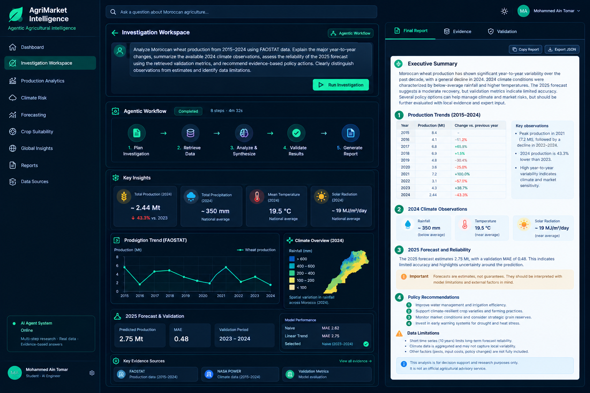

# AgriMarket Intelligence

**Agricultural production analytics, climate-risk exploration, forecasting, and evidence-grounded AI investigations for Morocco.**

AgriMarket Intelligence brings agricultural production data and climate indicators into one workspace. It combines a Python API, a web dashboard, forecasting outputs, and an AI investigation workflow to help users explore agricultural trends and examine possible risks.

> **Important:** This is a decision-support and portfolio project, not an official agricultural advisory service. Forecasts and climate associations should be interpreted with their data limitations in mind.

## What it does

- **Production analytics** — explore crop production histories and trends.
- **Climate exploration** — inspect available climate indicators for Morocco.
- **Forecasting** — view generated crop forecasts and model evaluation results.
- **AI investigations** — submit research questions to a multi-step workflow that can gather evidence and assemble a structured answer.
- **Evidence and validation views** — inspect retrieved evidence and workflow validation output alongside the analysis.
- **Report export** — copy the investigation report or export the returned result as JSON.
- **Web dashboard** — navigate the project's analytical sections through a single interface.

Features and results depend on the datasets and workflow components available in the current checkout.

## Architecture

| Component | Technology | Responsibility |
|---|---|---|
| API and data services | Python, Flask | Expose crop, climate, history, summary, and forecast endpoints |
| Investigation workflow | Python, LangGraph-based workflow | Coordinate investigation steps and assemble responses |
| Dashboard | Next.js, React, TypeScript | Present analytics and investigation reports |
| Data analysis | FAOSTAT and NASA POWER-derived datasets | Provide agricultural production and climate observations |
| Tests | pytest, TypeScript checks, Next.js build | Check backend behavior and frontend compilation |

### High-level flow

```text
FAOSTAT production data ─┐
                         ├─> Data and API services ─> Web dashboard
NASA POWER climate data ─┘              │
                                        └─> AI investigation workflow
                                                  │
                                                  v
                                       Analysis, evidence, and report
```

## Data sources

- **FAOSTAT** — agricultural production records used for crop history and trend analysis.
- **NASA POWER** — climate and meteorological data used for climate exploration.

The project includes processed datasets and derived outputs. Consult the repository's data-processing code and dataset metadata for exact coverage, units, locations, and processing choices.

## Getting started

### Requirements

- Python and `pip`
- Node.js and npm
- Git

### 1. Clone the repository

```bash
git clone https://github.com/Mohammed18-19/agrimarket-intelligence.git
cd agrimarket-intelligence
```

### 2. Set up the Python environment

```bash
python3 -m venv .venv
source .venv/bin/activate
python -m pip install --upgrade pip
```

Install the project's declared Python dependencies using the repository's dependency manifest and instructions. For example, if the project uses `pyproject.toml`:

```bash
pip install -e .
```

If editable installation is not configured for your environment, follow the dependency declarations in `pyproject.toml` instead.

### 3. Start the API

From the repository root, with the virtual environment active:

```bash
PYTHONPATH=src python -m agrimarket.api
```

The development API is expected at `http://127.0.0.1:5000`.

### 4. Start the dashboard

Open a second terminal:

```bash
cd agrimarket-intelligence/frontend
npm install
npm run dev
```

Open `http://localhost:3000`. Keep the API running while using dashboard features that require backend data. If your local API address differs, check the frontend API proxy configuration.

## API endpoints

The following endpoints have been exercised successfully in the local development environment:

| Endpoint | Purpose |
|---|---|
| `GET /api/health` | API health status |
| `GET /api/crops` | Available crops |
| `GET /api/climate` | Climate data |
| `GET /api/crops/Wheat/history` | Wheat production history |
| `GET /api/crops/Wheat/summary` | Wheat summary |
| `GET /api/crops/Wheat/forecast` | Wheat forecast |

These examples describe the local API; they do not imply a public deployment.

## Run checks

From the repository root:

```bash
source .venv/bin/activate
PYTHONPATH=src pytest -q
```

Check the frontend:

```bash
cd frontend
npx tsc --noEmit
npm run build
```

## Forecasting and interpretation

Forecast outputs are estimates, not guarantees. Historical production can be volatile, and short time series limit the reliability of extrapolation. Model errors should be considered alongside the forecast rather than hidden behind a single predicted value.

Climate indicators can provide context for agricultural analysis, but annual or spatial averages alone do not establish that a particular climate factor caused a production change. Regional conditions, seasonal timing, agricultural practices, and other external drivers may not be fully represented.

Policy ideas generated during an investigation should be treated as options for further assessment, not as validated recommendations. Decisions involving imports, stocks, irrigation, crop selection, or sowing dates require appropriate local evidence and expert review.

## Project status

The repository includes production and climate data workflows, crop analytics endpoints, forecast outputs, and a web-based AI investigation interface. The backend test suite and frontend production build have passed in the local development environment.

**Deployment status:** a successful local build does not mean the application is hosted publicly. A production deployment, if desired, requires separate hosting and configuration.

## Future improvements

- Broaden forecast evaluation and compare against simple baselines on clearly defined chronological holdouts.
- Improve uncertainty communication and document model limitations per crop.
- Strengthen evidence-grounding and handling of questions that the available data cannot answer.
- Add verified regional and seasonal analyses where the data supports them.
- Publish reproducible setup instructions, example investigations, and screenshots of the running application.

## Author

**Mohammed Ain Tomar**

- GitHub: [Mohammed18-19](https://github.com/Mohammed18-19)
- Project repository: [agrimarket-intelligence](https://github.com/Mohammed18-19/agrimarket-intelligence)

## Agentic Investigation Workspace



*Concept preview of the LangGraph-powered investigation workflow, evidence retrieval, validation, and structured agricultural reporting.*
