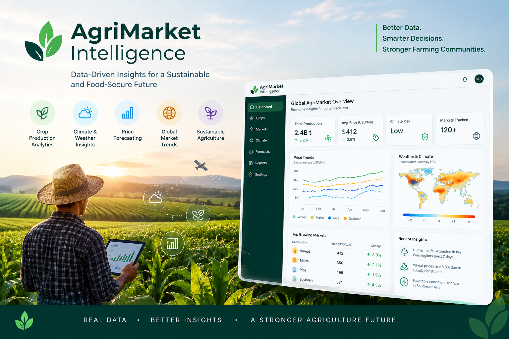
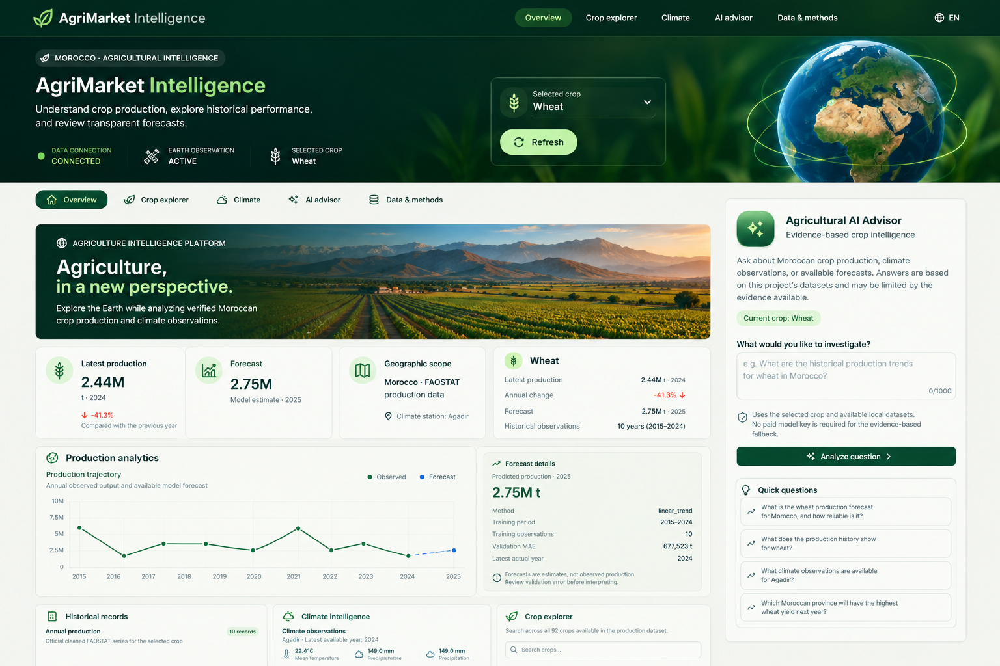

# AgriMarket Intelligence



**Better Data. Smarter Decisions. Stronger Farming Communities.**

AgriMarket Intelligence combines Moroccan crop-production statistics, climate data, production analytics, and forecasting to support data-informed agricultural decisions.


Agricultural production and climate intelligence for Morocco, built with Python and public datasets.

The project includes a Flask REST API and a Next.js dashboard for Moroccan crop-production history, year-over-year changes, annual climate indicators, and production forecasts.


## Dashboard Preview



## Implemented

- Clean and validate FAOSTAT crop production records.
- Calculate year-over-year production changes, handling missing years and zero previous-year production.
- Rank crops by annual production when units are comparable.
- Retrieve daily climate data from NASA POWER for five Moroccan locations.
- Aggregate daily climate observations into annual indicators.
- Test data validation and analytics with pytest.

## Data

### Agricultural production

- Source: FAOSTAT data stored locally in `data/raw/faostat_morocco_crops.csv`.
- Period: 2015–2024.
- Processed production data: `data/processed/faostat_morocco_production.csv`.
- Production trends: `data/processed/faostat_production_trends.csv`.

Rows with missing production values are excluded during cleaning. The trends dataset can contain missing comparison metrics where a crop has no previous consecutive year; these values should not be interpreted as zero change.

### Climate

- Source: NASA POWER daily point data.
- Locations: Agadir, Beni Mellal, Fes, Marrakech, and Meknes.
- Period: 2015–2024.
- Daily observations: `data/raw/nasa_power_morocco.csv`.
- Annual indicators: `data/processed/nasa_power_annual.csv`.

The annual climate dataset includes mean temperatures, mean daily maximum and minimum temperatures, total daily precipitation, mean daily solar radiation, and observed-day counts. The dataset represents five selected locations, not all of Morocco.

## Setup

Python 3.12 or newer is specified in `pyproject.toml`.

```bash
python -m venv .venv
source .venv/bin/activate
python -m pip install -e ".[dev]"
```

## Run the pipeline

Run commands from the repository root.

Process the existing FAOSTAT raw CSV:

```bash
python scripts/process_faostat.py
```

Aggregate the existing NASA POWER daily CSV:

```bash
python scripts/aggregate_climate.py
```

Calculate production trends:

```bash
python scripts/analyze_production.py
```

These scripts write processed files and may overwrite existing outputs. The NASA collection script makes external requests and should only be run when a fresh download is intended.

## Tests

```bash
pytest -q
```

## Future work

- Crop suitability analysis.
- Market-price forecasting (production forecasting is implemented).
- Risk and economic scenario analysis.
- LangGraph agent orchestration.
- Expanded API and dashboard capabilities.

## Current limitations

The current analytics are descriptive, not predictive. The project does not yet implement a forecasting model, market-price dataset, production-per-hectare yield model, agent workflow, API, or dashboard.
