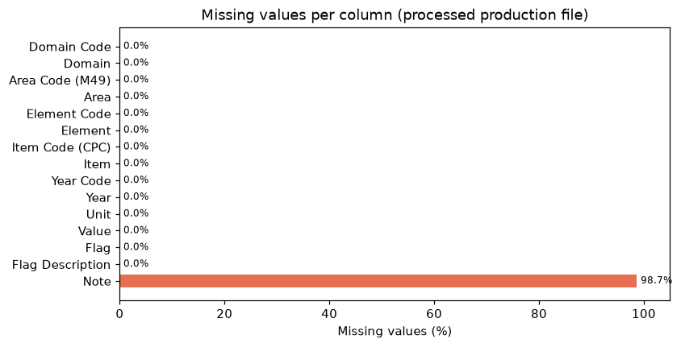
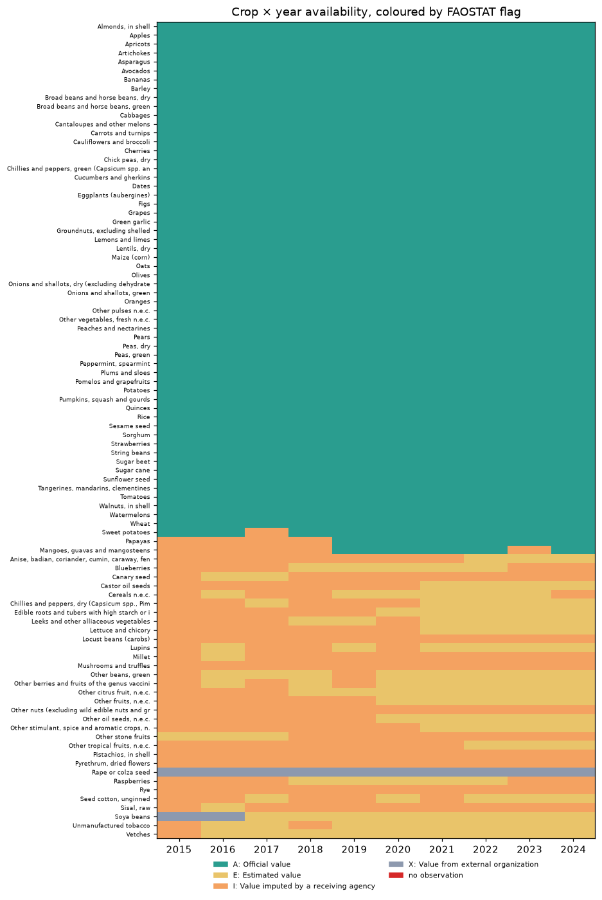
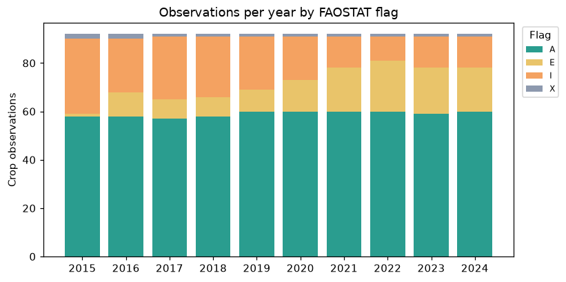
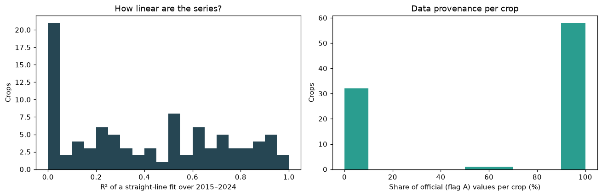
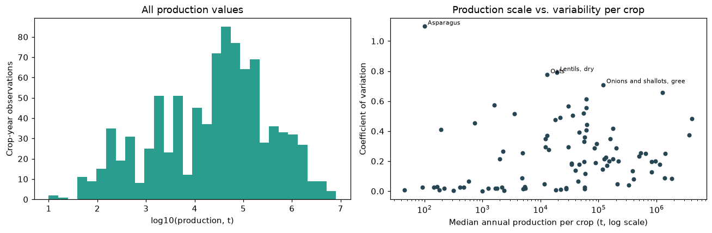
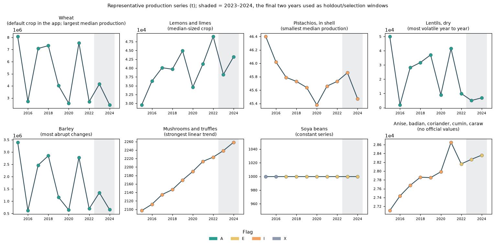
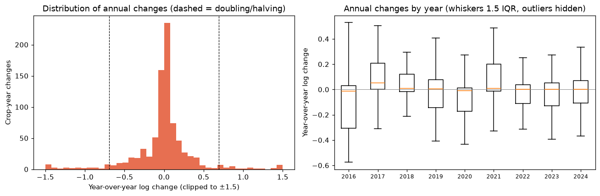
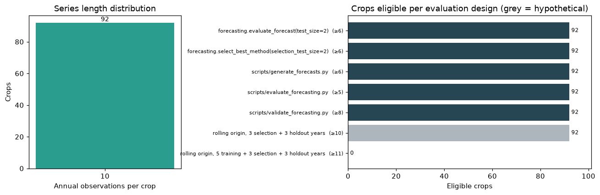

# Dataset EDA: crop production data used for forecasting

This report describes the data that the forecasting pipeline actually
reads, and what its structure means for evaluation design.

All numbers and figures are produced by
[`scripts/forecasting/eda_forecasting.py`](../../../scripts/forecasting/eda_forecasting.py).
Tables are in [`results/`](results/) and figures in [`figures/`](figures/).
Statements marked *Interpretation* go beyond what the dataset itself shows.

- [1. Data sources and preprocessing](#1-data-sources-and-preprocessing)
- [2. Structure](#2-structure)
- [3. Data quality](#3-data-quality)
- [4. Data provenance](#4-data-provenance)
- [5. Time-series characteristics](#5-time-series-characteristics)
- [6. Feasibility of evaluation designs](#6-feasibility-of-evaluation-designs)
- [7. Implications for evaluation design](#7-implications-for-evaluation-design)

## 1. Data sources and preprocessing

| File | Used by forecasting | Content |
|---|---|---|
| `data/processed/faostat_morocco_production.csv` | Yes, the only input | FAOSTAT QCL production, Morocco, 2015–2024 |
| `data/processed/nasa_power_annual.csv` | No | NASA POWER annual climate for 30 locations, 2015–2024, no missing values ([`climate_coverage.csv`](results/climate_coverage.csv)) |
| `data/raw/faostat_morocco_crops.csv` | Indirectly | Raw FAOSTAT export; gitignored and **not present** in this checkout |

The processed file is created by `scripts/process_faostat.py`, which keeps
rows with `Element == "Production"` and a non-missing `Value`. It then
rejects empty data, duplicate rows, and years outside 2015–2024. Because the
raw export is not in the repository, the raw-versus-processed comparison
could not be computed ([`raw_vs_processed.csv`](results/raw_vs_processed.csv)).
The script runs that comparison automatically when the raw file is present.
What the preprocessing removed (other FAOSTAT elements such as area harvested
or yield, other items, missing values) is therefore known only from the code,
not measured.

The forecasting code reads the processed file as-is. Each script applies
`pd.to_numeric` to `Year` and `Value`, drops missing rows, and
`_get_crop_series` then validates each crop
(see [forecasting_code_audit.md](forecasting_code_audit.md#3-models)).

## 2. Structure

| Property | Value |
|---|---|
| Rows × columns | 920 × 15 |
| Area | Morocco only |
| Element | Production only |
| Crops (`Item`) | 92, one `Item Code (CPC)` each |
| Years | 2015–2024 (10 years) |
| Unit | `t` (tonnes) for every row |
| Crop-year cells | 920 of 920 observed |

Column types and missingness: [`column_profile.csv`](results/column_profile.csv).
Of the 15 columns, the forecasting code uses `Item`, `Year`, `Unit`, and
`Value`. `Year Code` equals `Year` on every row. `Flag` and
`Flag Description` record data provenance (Section 4) and are not used by
any forecasting code today.

The only target is annual production in tonnes. The data contains no yield,
harvested area, price, or other indicator. Each series is a single crop at
national level; there is no regional breakdown.

Per-crop statistics (count, range, mean, median, standard deviation,
coefficient of variation, trend fit, flags, and the current validation
status) are in [`crop_series_summary.csv`](results/crop_series_summary.csv).

## 3. Data quality

| Check | Result |
|---|---|
| Missing `Value` | 0 |
| Missing in any column except `Note` | 0 |
| `Note` missing | 908 of 920 (98.7%); the 12 notes all read "Unofficial figure" |
| Duplicate rows / duplicate crop-years | 0 / 0 |
| Missing years inside a crop's span | 0 |
| Non-finite, zero, or negative values | 0 |
| Units per crop | 1 (`t`) |
| Crops rejected by `_get_crop_series` | 0 |

The panel is complete: every crop has a value for every year. Every quality
rule enforced by the forecasting code passes. As a result, the current data
cannot exercise the code paths that exclude incomplete series (see
[audit issue I-8](forecasting_code_audit.md#i-8-different-eligibility-rules-per-entry-point--medium)).

### Constant and repeated values

- **Soya beans** is constant: 1,000 t in all ten years. Its flags are two
  external-organization values followed by eight estimated values. Every
  forecast method scores zero error on it.
- Seven more crops repeat a value in consecutive years, most notably
  *Rape or colza seed* (5 repeats) and *Sesame seed* (3).

### Abrupt changes

An abrupt change is a year-over-year change of at least a doubling or a
halving. There are 64 abrupt changes in 22 crops
([`abrupt_changes.csv`](results/abrupt_changes.csv)). Thirteen crops have
at least one *spike*, a year that jumps away from both neighbours by that
factor. There are 23 spikes in total.

These changes are concentrated in cereals and pulses: Barley and dry peas
have 6 abrupt changes each; lentils, oats, and dry broad beans 5; Wheat
and asparagus 4. Twenty-one of the 22 crops have only officially reported
values, so these swings are not artefacts of imputation. The largest single
change is dry lentils falling from 50,004 t in 2015 to 2,004 t in 2016,
then rising to 28,163 t in 2017.

*Interpretation:* the affected crops are largely rain-fed field crops, and
the low years (for example 2016, 2020, 2022, 2024 for Wheat and Barley) are
consistent with dry seasons. The dataset does not contain rainfall for the
growing areas, so this is not established here.

A level-based outlier score (robust z on log production) was tried and
discarded. On ten-point trending series it mostly flagged small deviations
in smooth imputed series.

## 4. Data provenance

| Flag | Meaning | Rows | Share |
|---|---|---:|---:|
| A | Official value | 590 | 64.1% |
| I | Value imputed by a receiving agency | 193 | 21.0% |
| E | Estimated value | 125 | 13.6% |
| X | Value from external organization | 12 | 1.3% |

Source: [`flag_summary.csv`](results/flag_summary.csv).

Provenance is almost entirely a per-crop property: 57 crops are official
in every year, 32 crops have **no** official value in any year, and only
three (*Mangoes, guavas and mangosteens*, *Papayas*, *Sweet potatoes*)
mix both. Over time, imputed values (I) were gradually replaced by
estimated ones (E), while the number of official values stayed at 57–60
per year.

The two groups behave very differently:

| Crops | Count | Median coefficient of variation | Median mean absolute annual log change | Crops with linear-trend R² ≥ 0.5 |
|---|---:|---:|---:|---:|
| All values official | 57 | 0.277 | 0.218 (about 24%) | 20 |
| No official values | 32 | 0.023 | 0.013 (about 1%) | 20 |

The series with no official values are nearly smooth lines, which is
consistent with values produced by an imputation or estimation model. A
forecast that extrapolates them is largely reproducing that model, not
predicting observed production. The forecasting code currently treats all
92 series the same way. The effect on reported errors is shown in
[audit issue I-6](forecasting_code_audit.md#i-6-cross-crop-aggregation-is-dominated-by-scale-and-by-data-provenance--high).

## 5. Time-series characteristics

### Length and coverage

Every crop has exactly 10 annual observations, 2015–2024. There is no
variation in series length to exploit or to handle.

### Scale

Median production per crop ranges from 45.73 t (pistachios) to 4,091,887 t
(Wheat), about five orders of magnitude. Total production across all crops
ranged from 29.7 million t (2015) to 18.5 million t (2024)
([`year_summary.csv`](results/year_summary.csv)). Most of that total comes
from a few large crops.

Variability is not tied to scale. Asparagus (about 100 t) has the highest
coefficient of variation (1.10), and Wheat (0.48) and Barley (0.66) are the
most variable large crops. Raw errors in tonnes can therefore not be
compared across crops, and percentage errors are unstable for small crops
with large swings.

### Trends and year-over-year change

The representative crops are chosen by rule in the script: the default app
crop, extremes of scale, the most volatile, the most abrupt changes, the
strongest trend, the constant series, and the first series without official
values.

- The median crop's mean absolute annual log change is 0.158, about a 17%
  move per year.
- A straight line explains at least half the variance (R² ≥ 0.5) for 41 of
  92 crops. Half of those are crops without official values. Twenty-one
  crops have R² below 0.05, and the constant Soya beans series has no
  defined R² at all.
- Wheat and Barley alternate between high and low years rather than
  following a trend. Under that pattern both a last-value forecast and a
  ten-year straight line have large errors.

By year, the median absolute log change is between 0.064 (2018) and 0.105
(2016). 2016, 2017, and 2021 have the most abrupt changes (10, 11, and 9
crops). The final two years, 2023 and 2024, are not unusual on these
measures: their medians are 0.075 and 0.084, with 7 and 8 abrupt changes.
The current holdout window is therefore not obviously easy or hard, but it
contains only these two years.

## 6. Feasibility of evaluation designs

With 10 observations per crop, every additional year reserved for
selection or testing removes a training year. All implemented entry points
and the most demanding feasible design use all 92 crops.

| Design | Minimum observations | Eligible crops |
|---|---:|---:|
| `generate_forecasts.py` / `select_best_method(2)` / `evaluate_forecast(2)` | 6 | 92 |
| `evaluate_forecasting.py` | 5 | 92 |
| `validate_forecasting.py` (2 selection + 2 holdout years) | 8 | 92 |
| *Hypothetical:* 4 training + 3 selection + 3 holdout years | 10 | 92 |
| *Hypothetical:* 5 training + 3 selection + 3 holdout years | 11 | 0 |

Source: [`evaluation_eligibility.csv`](results/evaluation_eligibility.csv).

In practice the budget is 10 points per crop, of which at least 4 must
train the first model. That leaves at most 6 years to split between method
selection and final testing.

### Model families

| Family | Feasibility on this data |
|---|---|
| Naive, drift, mean, linear trend | Feasible; parameter count is small relative to 4–8 training points |
| Exponential smoothing (simple, damped trend) | Feasible but weakly identified; 1–2 parameters on 4–8 points |
| ARIMA, seasonal models | Not meaningful per crop: annual data has no seasonality and too few points for order selection |
| Per-crop machine learning (trees, neural networks) | Not feasible: more parameters than observations |
| Pooled or global models across crops | Possible: 920 crop-years, about 828 one-step pairs. Requires scale normalisation and care with the 32 imputed series |
| Climate-driven models | Possible later, but the climate file is per location while production is national, and climate for the forecast year is unknown at forecast time |

## 7. Implications for evaluation design

1. **Tiny test sets.** Two holdout years per crop give 184 holdout forecasts
   in total, all from two calendar years. Method rankings from such a test
   are fragile; uncertainty should be reported, and rolling origins should
   reuse more years where possible.
2. **Selection and testing compete for the same years.** A design with 3
   selection and 3 holdout years is the maximum that keeps all crops at the
   4-year training minimum.
3. **Scale-free metrics are required.** Tonnes are comparable within a crop
   but not across crops.
4. **Report results by provenance.** The 32 crops without official values
   should be reported separately, or excluded from headline metrics, so that
   smooth imputed series do not mask errors on officially reported crops.
5. **Degenerate series need handling.** Constant series give zero errors for
   every method and break relative metrics that divide by naive error.
6. **Benchmarks must keep the naive forecast.** For volatile, alternating
   series a last-value forecast is the minimum a model must beat.
7. **Data-quality rules are currently untested on real data.** Because the
   panel is complete, the eligibility rules should be covered by synthetic
   test cases rather than inferred from this dataset.

Recommendations based on these findings are prioritised in
[findings_and_recommendations.md](findings_and_recommendations.md).
